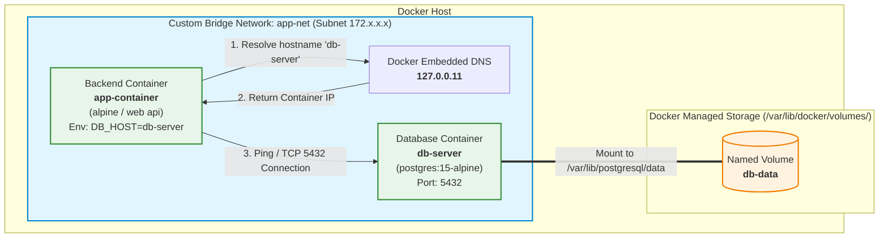

# Bài 4: Thiết lập Custom Network & Named Volume bằng Docker CLI

## 1. Thông Tin Bài Tập
- **Môn học / Khóa học:** IT209 - Docker & Containerization
- **Session:** Session 10 - Docker Networking & Storage Management
- **Bài tập:** Bài 4 (Exercise 4)
- **Đường dẫn thư mục bài nộp:** `homework/session_10/ex4/`
- **Tài liệu nộp:** `commands.sh`, `README.md`
- **Repository:** [https://github.com/mtuyen260609/IT209-ss10-b4](https://github.com/mtuyen260609/IT209-ss10-b4)

---

## 2. Mục Tiêu Thực Hành
1. **Custom Bridge Network (`app-net`):**
   - Thiết lập mạng cô lập tùy chỉnh (User-defined Bridge Network) cho cụm ứng dụng.
   - Kích hoạt cơ chế **Automatic Service Discovery / DNS Resolution**: Các container giao tiếp nội bộ với nhau trực tiếp thông qua tên container/hostname (`db-server`) thay vì phụ thuộc vào địa chỉ IP động.
2. **Named Volume (`db-data`):**
   - Tạo khối lưu trữ độc lập (Named Volume) do Docker quản lý.
   - Gắn (mount) vào thư mục lưu trữ dữ liệu của PostgreSQL (`/var/lib/postgresql/data`).
3. **Data Persistence Testing:**
   - Thực hiện kiểm chứng tính bền vững của dữ liệu qua kịch bản: Thêm dữ liệu ➔ Xóa cứng container Database (`docker rm -f db-server`) ➔ Khởi chạy một container DB mới toanh gắn cùng Volume `db-data` ➔ Xác minh 100% dữ liệu không bị mất mát.

---

## 3. Kiến Trúc Hệ Thống (Architecture Diagram)



---

## 4. Danh Sách Câu Lệnh Chi Tiết (Step-by-Step CLI Commands)

Tất cả các lệnh dưới đây được đóng gói và tự động hóa trong file script [commands.sh](file:///C:/Users/Admin/OneDrive/HRM/IT209-ss10-b4/homework/session_10/ex4/commands.sh).

### Bước 0: Dọn dẹp môi trường cũ (Cleanup)
Loại bỏ các container thử nghiệm trước đó nếu có để đảm bảo không bị xung đột tên:
```bash
docker rm -f db-server app-container 2>/dev/null || true
```

### Bước 1: Tạo Custom Bridge Network
Tạo mạng bridge riêng biệt mang tên `app-net`:
```bash
docker network create --driver bridge app-net
```
> **Ý nghĩa:** Khác với mạng bridge mặc định (`bridge`), mạng user-defined bridge tự động kích hoạt Docker Embedded DNS (chạy tại IP loopback `127.0.0.11`), cho phép container tra cứu IP của nhau qua tên service/container.

### Bước 2: Tạo Named Volume
Tạo ổ đĩa lưu trữ mang tên `db-data`:
```bash
docker volume create db-data
```
> **Ý nghĩa:** Named Volume được quản lý tập trung bởi Docker engine, nằm ngoài vòng đời của container và không bị xóa khi container bị tiêu hủy.

### Bước 3: Khởi chạy Database Container (`db-server`)
Chạy container PostgreSQL phiên bản `15-alpine`, gắn vào mạng `app-net` và mount volume `db-data`:
```bash
docker run -d \
  --name db-server \
  --network app-net \
  -v db-data:/var/lib/postgresql/data \
  -e POSTGRES_USER=postgres \
  -e POSTGRES_PASSWORD=postgres \
  -e POSTGRES_DB=appdb \
  postgres:15-alpine
```
Chờ PostgreSQL khởi động hoàn tất:
```bash
until docker exec db-server pg_isready -U postgres -d appdb >/dev/null 2>&1; do
  echo "Chờ DB khởi động..."
  sleep 2
done
```

### Bước 4: Khởi chạy Backend Container (`app-container`)
Khởi chạy container Backend tham gia mạng `app-net`, thiết lập biến môi trường trỏ kết nối DB đến hostname `db-server`:
```bash
docker run -d \
  --name app-container \
  --network app-net \
  -e DB_HOST=db-server \
  -e DB_PORT=5432 \
  -e DB_USER=postgres \
  -e DB_PASSWORD=postgres \
  -e DB_NAME=appdb \
  alpine tail -f /dev/null
```
> **Giải thích:** Sử dụng image `alpine` (có sẵn tiện ích `ping` siêu nhẹ) chạy nền bằng lệnh `tail -f /dev/null`. Container nhận biến môi trường `DB_HOST=db-server` để thực hiện kết nối.

---

## 5. Các Lệnh Kiểm Tra Theo Yêu Cầu Của Đề Bài

### 1. Kiểm tra Network đã tạo
```bash
docker network ls | grep app-net
```
**Kết quả mong đợi:**
```text
NETWORK ID     NAME      DRIVER    SCOPE
a1b2c3d4e5f6   app-net   bridge    local
```

### 2. Kiểm tra Named Volume đã tạo
```bash
docker volume ls | grep db-data
```
**Kết quả mong đợi:**
```text
DRIVER    VOLUME NAME
local     db-data
```

### 3. Kiểm tra chi tiết cấu hình Network và các Container tham gia
```bash
docker network inspect app-net
```
**Kết quả mong đợi:** Trường `Containers` hiển thị đồng thời cả `db-server` và `app-container` với các địa chỉ IP nội bộ cùng subnet (ví dụ `172.18.0.2` và `172.18.0.3`).

### 4. Kiểm tra DNS Resolution từ Backend sang DB
Thực hiện lệnh ping bằng hostname service từ bên trong container `app-container`:
```bash
docker exec -it app-container ping -c 2 db-server
```
**Kết quả mong đợi:**
```text
PING db-server (172.18.0.2): 56 data bytes
64 bytes from 172.18.0.2: seq=0 ttl=64 time=0.082 ms
64 bytes from 172.18.0.2: seq=1 ttl=64 time=0.067 ms

--- db-server ping statistics ---
2 packets transmitted, 2 packets received, 0% packet loss
round-trip min/avg/max = 0.067/0.074/0.082 ms
```
*(Tên miền `db-server` được Docker Embedded DNS phân giải chính xác thành địa chỉ IP nội bộ `172.18.0.2`).*

---

## 6. Kịch Bản & Kết Quả Kiểm Thử Tính Bền Vững Dữ Liệu (Data Persistence Test)

Quy trình 4 bước kiểm thử:

### Bước 6.1: Ghi dữ liệu mẫu vào PostgreSQL
Tạo bảng `users` và chèn 2 bản ghi:
```bash
docker exec -i db-server psql -U postgres -d appdb << 'EOF'
CREATE TABLE IF NOT EXISTS users (
    id SERIAL PRIMARY KEY,
    name VARCHAR(100) NOT NULL,
    email VARCHAR(100) UNIQUE NOT NULL,
    created_at TIMESTAMP DEFAULT CURRENT_TIMESTAMP
);

INSERT INTO users (name, email) VALUES 
('Nguyen Van A', 'nguyenvana@example.com'),
('Tran Thi B', 'tranthib@example.com');
EOF
```

Truy vấn kiểm tra dữ liệu trước khi xóa:
```bash
docker exec -i db-server psql -U postgres -d appdb -c "SELECT * FROM users;"
```
Output:
```text
 id |     name     |         email          |         created_at         
----+--------------+------------------------+----------------------------
  1 | Nguyen Van A | nguyenvana@example.com | 2026-10-11 06:00:00.123456
  2 | Tran Thi B   | tranthib@example.com   | 2026-10-11 06:00:00.123456
(2 rows)
```

### Bước 6.2: Xóa cứng (Hard Delete) Container `db-server`
Sử dụng cờ `-f` (force) để hủy diệt hoàn toàn container DB đang chạy:
```bash
docker rm -f db-server
```
Kiểm tra danh sách container để đảm bảo container cũ đã hoàn toàn biến mất:
```bash
docker ps -a --filter "name=db-server"
```
*(Kết quả trống: không còn container nào mang tên `db-server`).*

### Bước 6.3: Khởi chạy Container DB mới gắn cùng Volume `db-data`
Khởi tạo một container mới toanh từ image `postgres:15-alpine` và mount lại Volume `db-data`:
```bash
docker run -d \
  --name db-server \
  --network app-net \
  -v db-data:/var/lib/postgresql/data \
  -e POSTGRES_USER=postgres \
  -e POSTGRES_PASSWORD=postgres \
  -e POSTGRES_DB=appdb \
  postgres:15-alpine
```

### Bước 6.4: Xác minh dữ liệu không bị mất (Data Integrity Verification)
Truy vấn lại bảng `users` trên container mới:
```bash
docker exec -i db-server psql -U postgres -d appdb -c "SELECT * FROM users;"
```
**Kết quả hiển thị:**
```text
 id |     name     |         email          |         created_at         
----+--------------+------------------------+----------------------------
  1 | Nguyen Van A | nguyenvana@example.com | 2026-10-11 06:00:00.123456
  2 | Tran Thi B   | tranthib@example.com   | 2026-10-11 06:00:00.123456
(2 rows)
```
=> **Kết luận:** Cả hai dòng dữ liệu của người dùng `Nguyen Van A` và `Tran Thi B` vẫn còn nguyên vẹn 100%.

---

## 7. Giải Thích Nguyên Lý Kỹ Thuật (Key Concepts Explained)

| Thành phần | Đặc điểm & Cơ chế hoạt động |
| :--- | :--- |
| **Custom Bridge Network (`app-net`)** | - Cung cấp vùng mạng riêng cô lập với các container khác trên host.<br/>- Tích hợp **Docker Embedded DNS Server (`127.0.0.11`)** giúp tự động map tên container thành IP nội bộ mà không cần cấu hình file `/etc/hosts` thủ công.<br/>- Ngược lại với Default Bridge (`bridge`), default bridge không hỗ trợ automatic DNS resolution theo tên container. |
| **Named Volume (`db-data`)** | - Được lưu trữ tại `/var/lib/docker/volumes/db-data/_data` trên Docker Host.<br/>- Hoàn toàn tách biệt khỏi vòng đời của container (Container Lifecycle Decoupling).<br/>- Hiệu năng I/O tốt hơn so với bind mount trên nhiều hệ điều hành và an toàn, dễ quản lý qua Docker CLI. |
| **Biến môi trường kết nối** | - Backend container nhận `DB_HOST=db-server`. Khi backend gửi yêu cầu kết nối tới `db-server:5432`, resolver của hệ điều hành sẽ hỏi Docker DNS `127.0.0.11` và nhận về IP nội bộ của PostgreSQL container trên mạng `app-net`. |

---

## 8. Hướng Dẫn Chạy Script Tự Động

Cấp quyền thực thi và chạy file script `commands.sh`:
```bash
chmod +x commands.sh
./commands.sh
```
Hoặc:
```bash
bash commands.sh
```
Script sẽ tự động thực hiện toàn bộ các bước từ khởi tạo, kết nối, kiểm tra DNS và chạy test Data Persistence với output trực quan.
